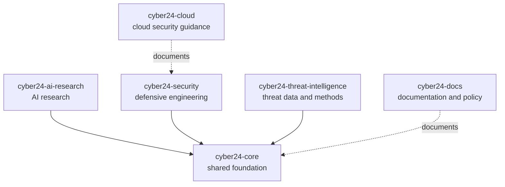

<div align="center">


### Rishan &nbsp;/&nbsp; Founder & Project Lead

[`ABOUT`](#about) · [`STATUS`](#system-status) · [`DIVISIONS`](#technology-divisions) · [`ARCHITECTURE`](#architecture) · [`ROADMAP`](#roadmap) · [`REPOSITORIES`](#repositories) · [`PRINCIPLES`](#principles)


</div>

---

## About

I am **Rishan**, founder and project lead of **CYBER24**, an enterprise-oriented technology initiative in **artificial intelligence and cybersecurity**, built under **Rishan Global Enterprises**.

CYBER24 is about one idea: intelligent systems and security engineering should strengthen each other. We research and build defensive, security-driven technology with rigorous engineering and honest reporting.

> **Honest status.** CYBER24 is in early-stage development and currently founder-led. Repositories are scaffolds. A capability is called available only after it is implemented and tested.

---

## System status

```text
$ cyber24 --status

  organization   CYBER24
  founder        Rishan
  industry       Artificial Intelligence & Cybersecurity
  positioning    Enterprise Technology
  stage          early-stage development
  team           founder-led (divisions not yet staffed)
  repositories   7 scaffolded
  releases       none yet
  use policy     defensive and research purposes only
```

---

## Mission and vision

| | |
| --- | --- |
| **Mission** | Research and build intelligent, security-driven technology that helps defenders, with rigorous engineering and honest reporting. |
| **Vision** | A trusted enterprise-grade technology organisation where AI and security engineering reinforce each other, and every claim is backed by tested work. |

---

## Technology divisions

| Division | Focus | Repository |
| --- | --- | --- |
| **AI Research** | Machine learning for defence and the security of AI systems | [`cyber24-ai-research`](https://github.com/CYBER24/cyber24-ai-research) |
| **Security Engineering** | Defensive tooling, hardening, secure engineering practice | [`cyber24-security`](https://github.com/CYBER24/cyber24-security) |
| **Threat Intelligence** | Schemas and methods for structuring and analysing threat information | [`cyber24-threat-intelligence`](https://github.com/CYBER24/cyber24-threat-intelligence) |
| **Cloud Security** | Secure cloud architecture, guidance, and benchmarks | [`cyber24-cloud`](https://github.com/CYBER24/cyber24-cloud) |
| **Software Engineering** | Shared codebase, testing standards, CI | [`cyber24-core`](https://github.com/CYBER24/cyber24-core) |
| **Research & Documentation** | Architecture, policies, research strategy, documentation | [`cyber24-docs`](https://github.com/CYBER24/cyber24-docs) |

*Divisions describe areas of responsibility. No division has assigned members beyond the founder yet, and members will be listed only when real people have joined.*

---

## Architecture



*Intended structure. No cross-repository dependencies exist yet.*

---

## Research areas

<details>
<summary><b>Directions under consideration</b> (not active programmes)</summary>

<br>

- Machine learning for anomaly and threat detection in defensive settings
- Security and robustness of AI systems, including misuse risks
- Structuring and assessing threat intelligence
- Cloud security configuration review and benchmarking
- Secure software engineering practices

</details>

---

## Development philosophy

| Principle | Meaning |
| --- | --- |
| **Security by design** | Security is a requirement from the first commit |
| **Modular architecture** | Clear boundaries, small units, easy to test |
| **Tested before claimed** | No feature is announced until it exists and passes tests |
| **Reproducible research** | Methods and data provenance are recorded |
| **Responsible practice** | Misuse and privacy are assessed before publishing |

---

## Technology stack

*Initial choices for the scaffold, subject to change.*


---

## Roadmap

*Planned, not promised. Nothing is complete until implemented, tested, and merged.*

| Phase | Focus | Status |
| --- | --- | --- |
| **0. Foundation** | Organization, repositories, CI, policies, documentation baseline | In progress |
| **1. Architecture and research baseline** | Architecture decisions, first research questions, testing standards | Planned |
| **2. First prototypes** | One narrow, tested prototype per active division | Planned |
| **3. Preview** | Security review, first pre-release, external feedback | Planned |

---

## Repositories

| Repository | Description |
| --- | --- |
| [`cyber24-core`](https://github.com/CYBER24/cyber24-core) | Shared libraries, application scaffolding, prototypes |
| [`cyber24-ai-research`](https://github.com/CYBER24/cyber24-ai-research) | AI research and evaluation workspace |
| [`cyber24-security`](https://github.com/CYBER24/cyber24-security) | Defensive security engineering |
| [`cyber24-threat-intelligence`](https://github.com/CYBER24/cyber24-threat-intelligence) | Threat data schemas, methods, templates |
| [`cyber24-cloud`](https://github.com/CYBER24/cyber24-cloud) | Cloud security guidance and benchmarks |
| [`cyber24-docs`](https://github.com/CYBER24/cyber24-docs) | Documentation, policies, brand guidelines |
| [`.github`](https://github.com/CYBER24/.github) | Organization profile and default templates |

---

## Principles

- **Defensive purpose only.** No malware, unauthorised access, or surveillance of individuals.
- **Responsible disclosure.** Vulnerabilities are reported privately and fixed openly.
- **Privacy first.** No personal data or credentials in repositories.
- **Honest claims.** Planned is labelled planned.

Full policy: [Acceptable use](https://github.com/CYBER24/cyber24-docs/blob/main/docs/acceptable-use.md) · [Security principles](https://github.com/CYBER24/cyber24-docs/blob/main/docs/security-principles.md)

---

## Collaborate

Interested in AI or security engineering? Read the contributing guidelines in any repository, open an issue or discussion before large changes, and follow the code of conduct. Security researchers: report vulnerabilities privately through a repository's **Security** tab.

<div align="center">

[](https://github.com/CYBER24)


</div>
